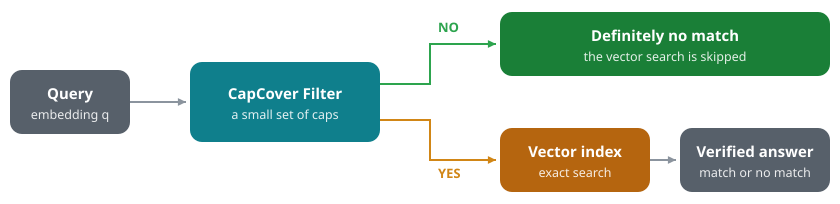
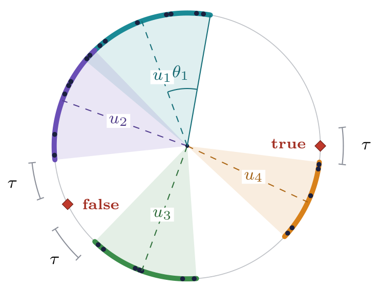
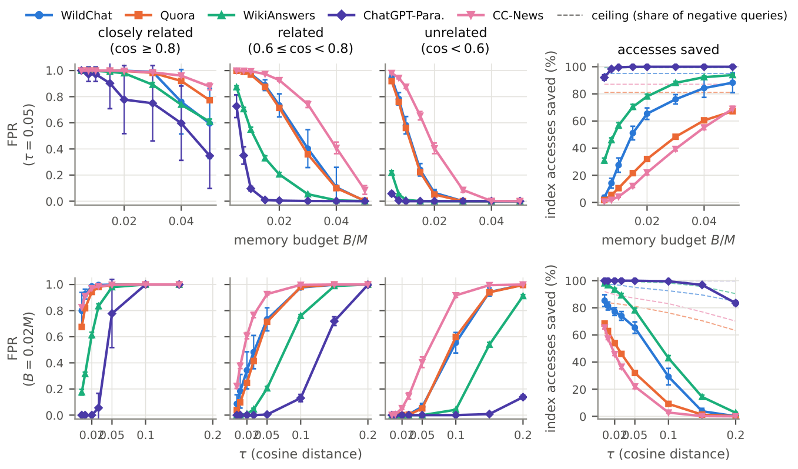
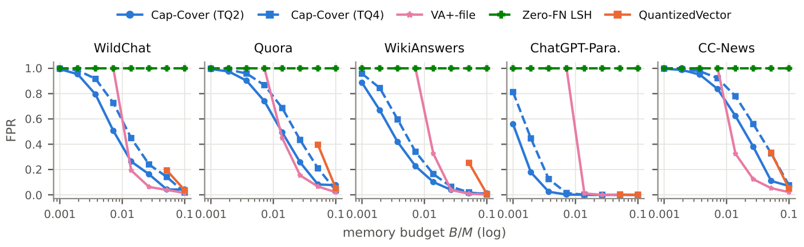

<p align="center">
  
</p>

<h3 align="center">Semantic Approximate Membership Queries over Embeddings</h3>

<p align="center">
  Know when a vector search can be skipped, with zero false negatives.
</p>

<p align="center">
  
  
  
</p>

<p align="center">
  <a href="#the-problem">The problem</a> &nbsp;·&nbsp;
  <a href="#how-it-works">How it works</a> &nbsp;·&nbsp;
  <a href="#building-a-cover">Building a cover</a> &nbsp;·&nbsp;
  <a href="#results">Results</a> &nbsp;·&nbsp;
  <a href="#when-to-use-it">When to use it</a> &nbsp;·&nbsp;
  <a href="#theory">Theory</a> &nbsp;·&nbsp;
  <a href="#installation">Installation</a>
</p>

<br>

<table align="center">
  <tr>
    <td align="center" width="200"><h3>0</h3>false negatives, by construction</td>
    <td align="center" width="200"><h3>2%</h3>of the raw embedding memory</td>
    <td align="center" width="200"><h3>20–100%</h3>of index accesses avoided</td>
    <td align="center" width="200"><h3>1</h3>filter for any query threshold</td>
  </tr>
</table>

<p align="center"><sub>Memory and savings measured at cosine similarity 0.95 on five real-world corpora; savings depend on the corpus.</sub></p>

## The problem

Semantic caches, retrieval pipelines and de-duplication systems often need a yes-or-no answer: **is any stored embedding similar enough to this query?** Answering that normally takes a vector search, even when the answer is no.

We call this a **Semantic Approximate Membership Query (SAMQ)**, the semantic counterpart of what a Bloom filter does for exact keys. CapCover Filter is a compact structure that sits in front of the index and answers it first. For an indexed set $X$ of unit vectors, a query $q$ and a cosine-distance threshold $\tau$, the exact predicate is

$$
M_X(q, \tau) = \mathbf{1}\left[\min_{x \in X} \bigl(1 - \langle q, x \rangle\bigr) \le \tau\right].
$$

The filter says YES whenever $M_X(q, \tau) = 1$, and may also say YES for some other queries. A NO is always correct, so a rejected query can safely skip the index.

<p align="center">
  
</p>

## How it works

Unit-normalized embeddings lie on a sphere. CapCover Filter stores a small set of **spherical caps** that together contain every indexed vector. Each cap is only a direction $u_i$ and an angle $\theta_i$:

$$
C(u_i, \theta_i) = \lbrace x \in S^{d-1} : \angle(x, u_i) \le \theta_i \rbrace.
$$

<p align="center">
  
</p>

**Figure 1.** Embeddings are covered by caps, each defined by a direction $u_i$ and an angle $\theta_i$. At query time each cap is widened by the angle that corresponds to $\tau$. The query marked "true" lands inside a widened cap and goes on to verification. The query marked "false" lands outside all of them and is rejected.

A query is accepted if it falls inside at least one widened cap:

$$
\angle(q, u_i) \le \theta_i + \alpha_\tau \quad \text{for some } i, \qquad \alpha_\tau = \arccos(1 - \tau).
$$

> **Why a NO is always correct.** If $q$ is within $\tau$ of an indexed vector $x$, and $x$ lies in cap $i$, the triangle inequality for angles gives $\angle(q, u_i) \le \angle(q, x) + \angle(x, u_i) \le \alpha_\tau + \theta_i$. So $q$ is always accepted.

Two more properties follow from this design:

- **Threshold independence.** The caps depend only on the indexed vectors and the memory budget. $\tau$ appears only at query time, so one filter serves many thresholds without being rebuilt.
- **A fixed byte budget.** Each cap can summarize many vectors, and the budget sets how many caps fit. A tighter budget adds false positives, never false negatives.

## Building a cover

False positives come from the excess space inside the caps, so the goal is a valid cover with small total volume. For a given byte budget:

| Step | Method | What it does |
|:---:|---|---|
| 1 | **Farthest-first traversal** | Picks well-spread initial directions (Gonzalez) |
| 2 | **Minimax refinement** | Moves each direction toward the center of its members' enclosing cap |
| 3 | **Soft anneal** | Optimizes all directions together on the sphere to reduce the total cap volume $\sum_i \sigma(\theta_i)$, and keeps the best real cover it finds |
| 4 | **Quantization** | Compresses the directions so more caps fit, then re-measures every angle so coverage still holds |

The filter builds a cover for each candidate encoding and keeps the one with the smallest cap volume.

The paper evaluates this static construction. The implementation also supports insertions.

## Results

We evaluate on five real-world corpora (WildChat, Quora, WikiAnswers, ChatGPT-Paraphrases and CC-News), embedded with all-MiniLM-L6-v2 ($d = 384$). Each of the five folds indexes 80,000 vectors and queries with 20,000 others. Memory is reported relative to the raw float32 embeddings, about 123 MB at this size.

<p align="center">
  
</p>

**Figure 2.** Top: varying the memory budget at $\tau = 0.05$. Bottom: varying $\tau$ at 2% memory. The first three columns show the false-positive rate for negative queries, grouped by similarity to their closest indexed vector. The last column shows index accesses saved, with each corpus's share of negative queries dashed.

Compared with other zero-false-negative methods at equal memory, the geometric cover gives useful rejection at very small budgets, where the alternatives are ineffective or do not fit.

<p align="center">
  
</p>

**Figure 3.** Mean false-positive rate of zero-false-negative methods at equal memory budgets, at $\tau = 0.05$.

## When to use it

| Works best with | Helps less with |
|---|---|
| Tight thresholds, as in paraphrase detection and de-duplication | Looser thresholds, which widen every cap |
| Very limited memory and clustered embeddings | Larger budgets, where point-level methods such as VA+-file can reach a lower false-positive rate |
| Many queries that have no match | Negatives close to the indexed set, which stay hard to reject |
| Expensive backend lookups | Cheap lookups: with filter cost $F$, rejection rate $r$ and lookup cost $L$, the filter pays off only when $L \gt F / r$ |

## Theory

The paper proves that:

- Every valid cover has zero false negatives, including covers with quantized directions.
- Exact angular decoding of a ball cover accepts no more than Euclidean expansion of the same balls.
- Farthest-first construction has a factor-two guarantee on the largest cap radius, which does not extend to cap volume.
- The false-positive rate is bounded by the geometry of the cover and by how many queries fall near the true decision boundary.
- Any structure that guarantees a low false-positive rate under uniform queries, for every dataset, needs a minimum amount of space, whatever its encoding.

<details>
<summary><b>Key formulas</b></summary>

<br>

**Farthest-first guarantee.** The largest cap angle of the farthest-first cover $\mathcal{C}_G$ is at most twice the best possible with $k$ caps:

```math
R(\mathcal{C}_G) \le 2 R^\star_k(X).
```

**False-positive bound.** Under uniform queries, the total measure of the widened caps bounds the false-positive rate:

```math
\mathrm{FPR}_\nu(\mathcal{C}, \tau) \le \min\lbrace 1, J_\tau(\mathcal{C}) \rbrace, \qquad J_\tau(\mathcal{C}) = \sum_i \sigma(\theta_i + \alpha_\tau).
```

**Space lower bound.** Take any deterministic structure that represents every set of $n$ points on the sphere in $\mathcal{B}$ bytes, with no false negatives and a uniform-query false-positive rate of at most $\varepsilon$. Then

```math
\mathcal{B} \ge \frac{n}{8} \log_2 \frac{1}{\sigma\bigl(\sigma^{-1}(\eta) - \alpha_\tau\bigr)}, \qquad \eta = \varepsilon + (1 - \varepsilon) n \sigma(\alpha_\tau) \lt 1.
```

</details>

## Installation

CapCover Filter is implemented in Python with a Rust query kernel, and uses FAISS for exact search. It requires Python and the [Rust toolchain](https://rustup.rs/). The commands below install the Python dependencies and compile the Rust query kernel. Tested with Python 3.13 and Rust 1.91 on Windows.

```bash
git clone https://github.com/dbiton/SemanticAMQ.git
cd SemanticAMQ
pip install -r requirements.txt
pip install ./CapCoverRustFilter
```

## License

© 2026 Dvir David Biton, Shay Hahiashvili, Nadav Keren, Gil Einziger, Roy Friedman
